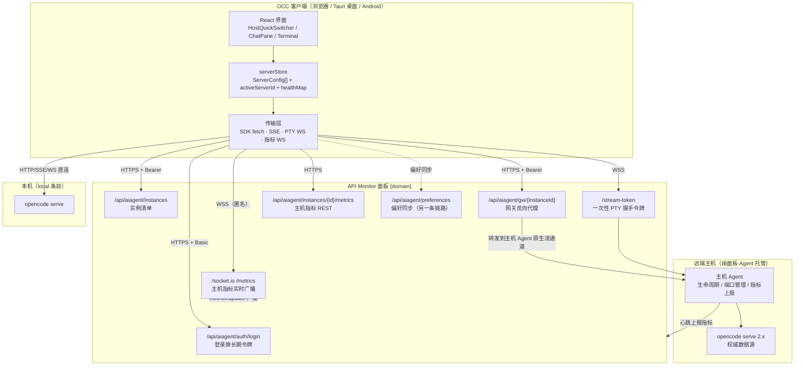
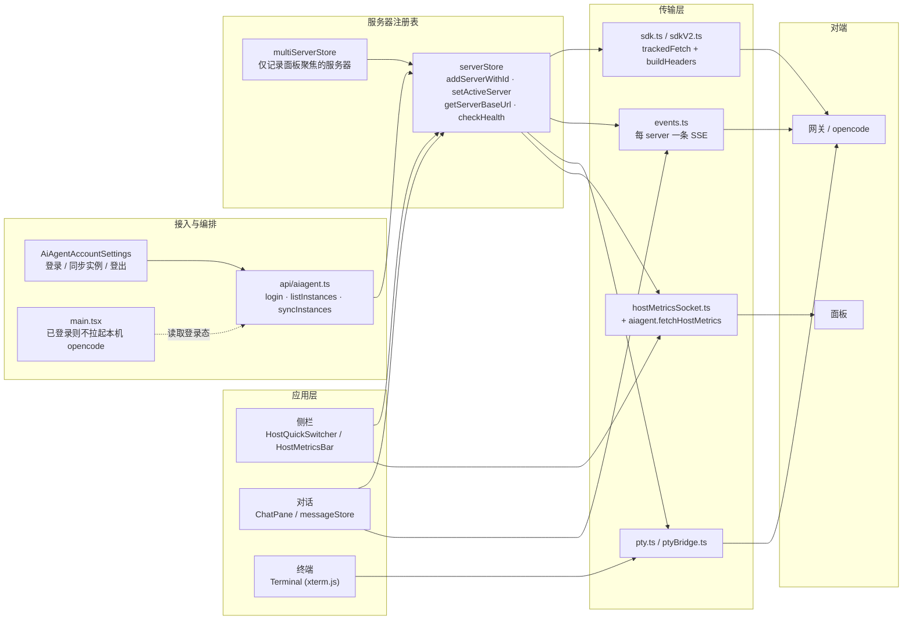
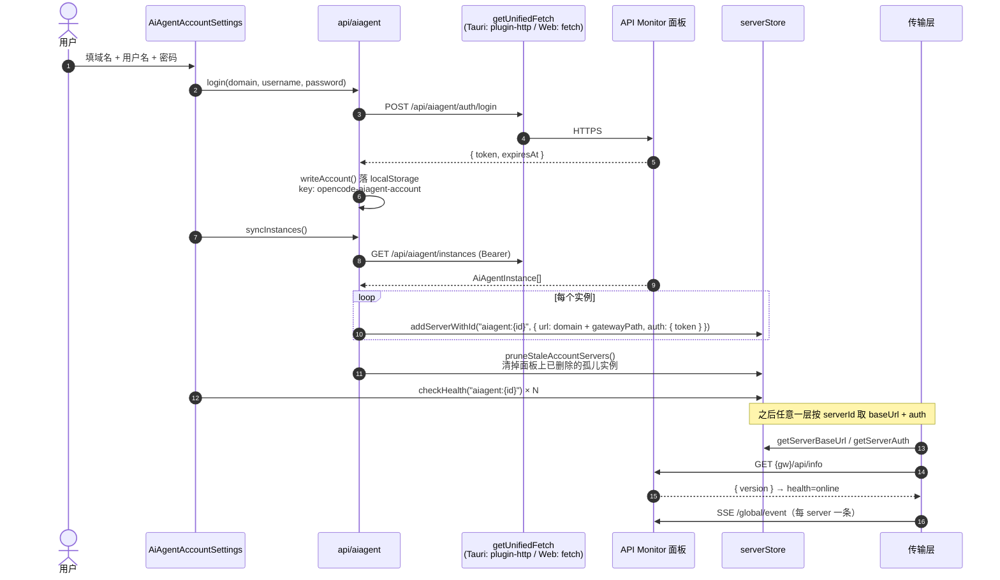
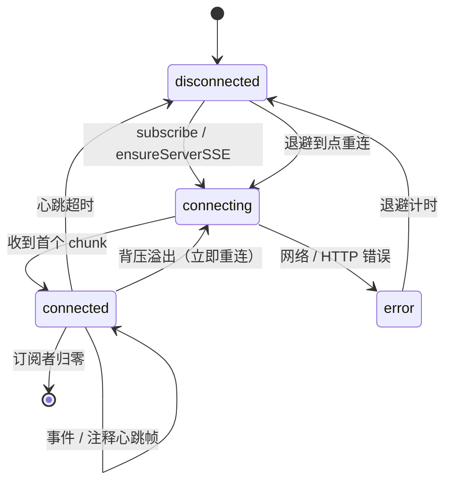
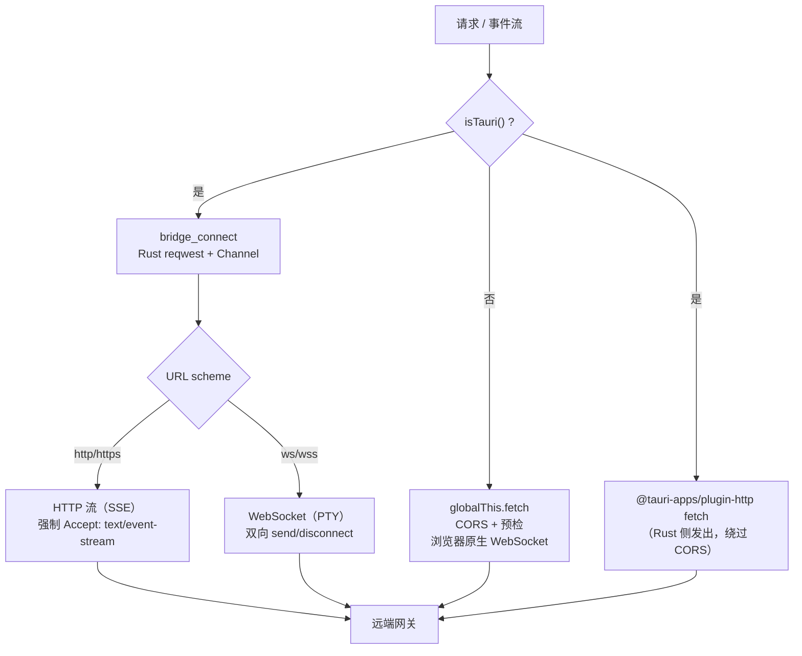
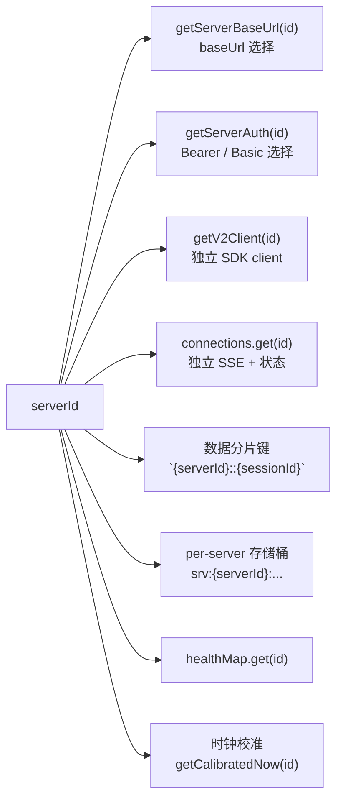
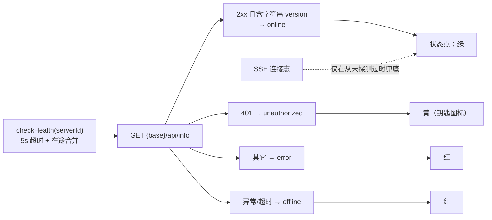
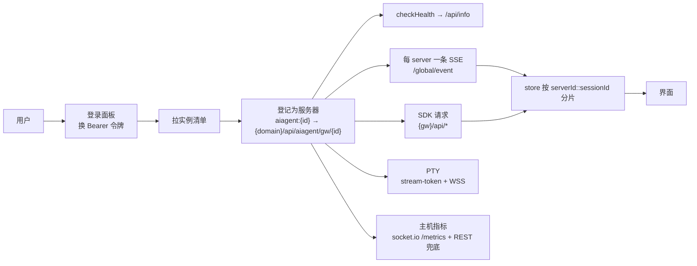

# Agent 远程连接架构

状态：**梳理文档（依据当前代码，非设计方案）**
核对基线：`0983e446`（v2.0.58）+ 工作区未提交改动（`HostMetricsBar` / `hostMetricsSocket` 等）
配套：`docs/design/同步拓扑图.md`（跨端同步拓扑）、`docs/design/数据同步层设计.md`

---

## 0. 一句话结论

OCC 前端**不直连远端 opencode**。远端连接统一收敛为「**一台远端 opencode = 一个 serverStore 服务器条目**，其 `url` 指向 API Monitor 面板上的 **AI Agent 网关** `{domain}/api/aiagent/gw/{instanceId}`」，鉴权用面板签发的 **Bearer 模块令牌**；本机 opencode、手填 URL 直连、网关连接三者共用**同一套 serverId 抽象**，上层（SDK / SSE / PTY / 指标）只按 `serverId` 取 baseUrl 与 auth。

---

## 1. 两种连接形态

| 形态 | serverId | url | 鉴权 | 建立方式 |
| --- | --- | --- | --- | --- |
| 本地 | `local`（`LOCAL_SERVER_ID`） | `API_BASE_URL`，运行时由 `setLocalServerRuntimeUrl()` 覆盖为实际监听地址 | 通常无 | 默认条目，`serverStore.ts:139`、`:509` |
| 远端（网关） | `aiagent:{instanceId}` | `{domain}{gatewayPath ?? /api/aiagent/gw/{id}}` | `Bearer <模块令牌>` | 登录面板 → 拉实例 → 自动登记，`aiagent.ts:235-243` |
| 远端（直连） | `server-{ts}-{rand}` | 用户手填 | Basic（用户名+密码） | 设置页手动添加 |

远端两种形态在传输层完全同构：都只是「一个 url + 一个 auth 的 ServerConfig」。差异仅在于凭据来源与网关侧的转发行为。

`makeAuthHeader()`（`serverStore.ts:891`）是唯一的凭据选择点：**有 `token` 走 Bearer，否则回退 Basic**。AI Agent 实例的 `auth.password` 刻意留空（`aiagent.ts:241`），避免误走 Basic。

---

## 2. 物理部署拓扑

要点：

1. **没有任何中央数据服务**：会话与消息的权威源始终是主机上的 `opencode serve`，面板只做**转发/鉴权/实例编排**（`aiagent.ts:5-8` 注释明确「数据经主机 Agent 的原生流通道到达本机 Agent 服务，不需要开放公网端口」）。
2. 远端主机**不需要开放公网端口**：主机 Agent 主动出站连面板，前端只连面板。
3. 指标广播 `/metrics` 命名空间**匿名可读**，前端不带模块令牌（`hostMetricsSocket.ts:24-26`），仅按 `serverId` 过滤自己关心的机器。

---

## 3. 客户端内部逻辑架构

---

## 4. 连接建立时序（首个远端实例）

对应代码：`aiagent.ts:180-215`（login）、`aiagent.ts:245-258`（syncInstances）、`AiAgentAccountSettings.tsx:112-128`（逐个真实探测）。

---

## 5. 数据通道矩阵

| 通道 | 协议 / 端点 | 客户端实现 | 鉴权 | 重连策略 |
| --- | --- | --- | --- | --- |
| 请求-响应（会话、消息、配置） | HTTPS → `{gw}/api/*` | `sdkV2.getV2Client(serverId)` | `Authorization: Bearer`（`sdk.ts:122`） | 30s 超时，按代次可批量取消（`sdk.ts:64`） |
| 实时事件 | SSE → `{gw}/global/event` | `events.connectViaV2` | 同上 | 心跳 + 指数退避 + 后台 keepalive（见 §6） |
| 终端 | WS → `{gw}/api/pty/{id}/connect` | `pty.ts` / `ptyBridge.ts` | Tauri：header；浏览器：先换一次性 `st` | 由组件层重连 |
| 主机指标（实时） | WSS → `wss://{domain}/socket.io /metrics` | `hostMetricsSocket.ts` | 匿名 | 1s→30s 指数退避 |
| 主机指标（兜底） | HTTPS → `/api/aiagent/instances/{id}/metrics` | `aiagent.fetchHostMetrics` | `Bearer` | 定时轮询（后台标签页跳过） |
| 偏好同步 | HTTPS + SSE → `/api/aiagent/preferences[/events]` | `preferencesSync*` | `Bearer` | 独立链路，见 `同步拓扑图.md` |

### 5.1 SSE 通道（核心）

每个 serverId **一条独立 SSE 连接**，各自维护心跳、重连、状态与事件代次（`events.ts:3-7`、`:1167`）。

关键设计（均有代码依据）：

- **「连接活着」与「有新事件」是两个信号**：SDK 只在 `data` 非空时 yield，注释心跳帧（服务端实测 15s 一次）不会进入 `for await`。因此订阅时传 `onActivity`，每收到 chunk（含注释帧）调用 `touchConnection` 顺延心跳，避免空闲会话 60s 被误判断连（`events.ts:220-250`、`数据同步层设计.md:803`）。
- **代次（generation）防串流**：每次重连先 `generation++` 再 abort 旧 controller，旧流的残留迭代直接 break，避免同一条 `text.delta` 被追加两次（`events.ts:305-312`）。
- **背压与断线区别对待**：SDK subscriber 队列溢出（4096）不是网络故障，立即重连、不作废退避、作废 seq 水位；断线走指数退避（`events.ts:395-420`）。
- **缺口检测**：`checkSeqGap` 在映射之前执行（seq 只在原始事件上），构成缺口的事件丢弃，等上层快照重拉（`events.ts:354-358`）。
- **移动端后台**：`visibilitychange` / 网络事件 + `startBackgroundKeepalive` 巡检，后台用更宽松的超时与更激进的重连（`events.ts:440-495`）。

### 5.2 传输实现（Tauri vs 浏览器）

- `getUnifiedFetch()`（`serverStore.ts:13`）是**面板 API（登录、实例、指标 REST）**的统一出口；`sdk.ts` 另有一份 Tauri fetch 缓存与 `trackedFetch` 负责 opencode 请求。
- Tauri 侧事件流走 `bridge_connect`，`bridgeId = "sse:{serverId}"`（`events.ts:94`），Rust 侧 `BridgeKey=(window, bridgeId)` 天然支持多服务器并发连接。
- **`Accept: text/event-stream` 是经网关时的流式判定依据**：缺失会被面板当普通请求整体缓冲，事件流约 60s 超时（`bridge.rs:141-144` 注释）。
- 浏览器模式下 PTY 的 WS 无法自定义 header，因此先 `POST {gw}/stream-token` 换 30s 一次性 `st` 令牌；换取失败时**宁可不带凭据让握手失败**，绝不回退到把长期密码写进 URL（`pty.ts:145-190`、`ptyCredentials.ts:11-14`）。

---

## 6. serverId 作为全局作用域键

远端连接能「无感」接入的关键在于：**serverId 是所有层的第一等作用域维度**。

- **一切 API 的末位参数都是 `serverId?`**，缺省取 `getActiveServerId()`（如 `client.ts:79`、`pty.ts:47`）。
- **连接集合**由 `collectActiveServerIds()` 计算：所有已启用服务器 + 当前活动服务器 + 已打开会话所属服务器（即使已被移除也要收尾），并过滤掉未注册 id，防止 `getServerBaseUrl` 静默回退 local 导致「数据串服」（`useGlobalEvents.ts:572-587`）。
- **切换服务器不重连 SSE**：多服务器模式下每台常驻一条连接，`server-switch` 只做幂等 `ensureServerSSE`；只有 `local-runtime-url` 变化才重连并 `abortInFlightApiRequests`（`main.tsx:63-100`、`events.ts:40-45`）。
- **时钟校准按 serverId 存**：跨主机比较通知/已读水位时统一到「会话所属主机」的时钟（`serverStore.ts:470-490`）。

---

## 7. 健康状态与降级

- 健康检查**在途合并**：同一 serverId 并发触发只发一次网络（`serverStore.ts:590-620`）。
- **状态点以健康探测为准，SSE 仅补 connecting 过渡态**：进程死后 SSE 长连接可能还挂着，5s 超时的真实探测能立刻判离线（`hostStatus.ts:22-40`）。
- 已登录 AI Agent 账号时，桌面端**不再自动拉起本机 opencode**，避免与面板托管的实例抢端口（`main.tsx:126-140`）。
- 实例被面板删除时 `pruneStaleAccountServers` 清本地条目；若删的是活动服务器，回退到其它可用服务器（`aiagent.ts:264-290`）。

---

## 8. 凭据边界（现状与已知缺口）

| 层 | 现状 | 依据 |
| --- | --- | --- |
| 面板账号令牌 | 明文存 `localStorage`（`opencode-aiagent-account`） | `aiagent.ts:12`、`:72-86` |
| 服务器 auth | 存 `localStorage`（`opencode-servers`），导出备份时剥离 | `serverStore.ts:139`、`:700-712` |
| 渲染进程凭据 | **仍在渲染进程内存**，`buildHeaders()` 在前端拼 Authorization | `credentialModel.ts:19-32` |
| 宿主代持 | Rust 侧已有 `credential_set/has/delete`（`credentials.json` 0600），但**尚未接入请求链路** | `credentials.rs:1-20`、`credentialModel.ts:49-52`（恒 false） |
| PTY 握手 | 一次性短令牌 `st`，不再把长期密码写进 URL | `pty.ts:145-190` |
| 令牌过期 | `expiresAt` 仅存储、**无主动刷新/过期处理** | `aiagent.ts:18`、`:207` |

桌面端的最终方向是「按 origin 在 Rust 侧注入鉴权头，前端不再持有密码」，但迁移会同时影响 Web / 桌面 / Android 的所有 code path，故单独排期。

---

## 9. 未在本仓库的部分

以下组件只通过契约（HTTP/WS 端点）被引用，实现不在本仓库，图中按契约标注：

- 面板的 `/api/aiagent/*` 路由与 `gw/{instanceId}` 反向代理；
- 主机 Agent（生命周期管理、原生流通道、每 10~30s 指标上报，见 `aiagent.ts:300-320`）；
- 面板的 Socket.IO `/metrics` 命名空间与 MetricsHub。

另外，`src-router`（Rust，`main.rs`）是**自托管部署**场景下的端口路由 / Caddy 反代网关，与本文件描述的「API Monitor 面板网关」是两套不同机制，不要混淆。

---

## 10. 一页速览

